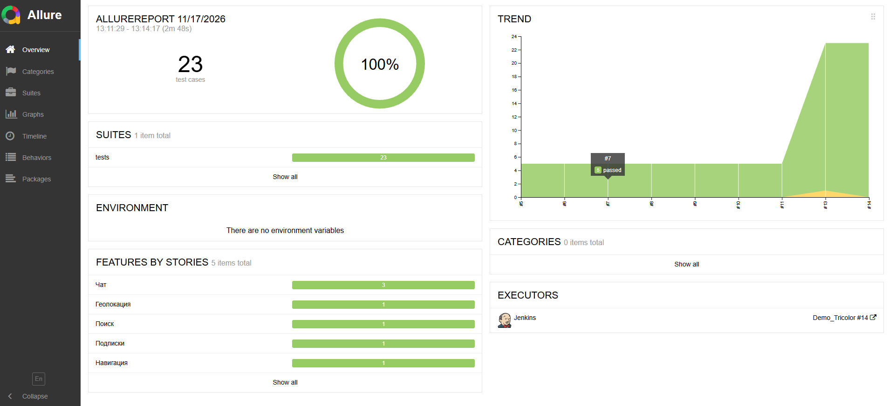
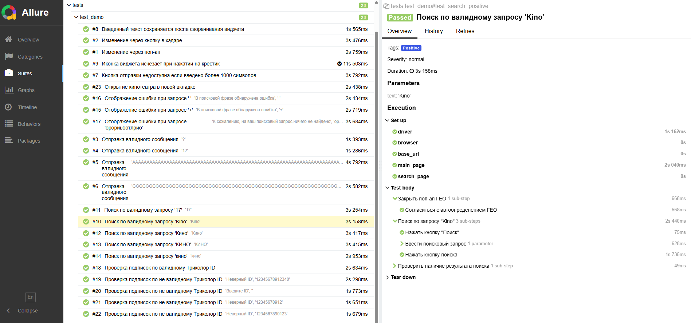
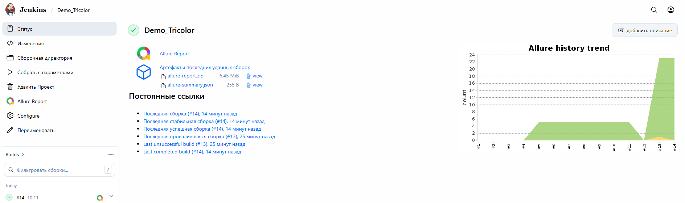
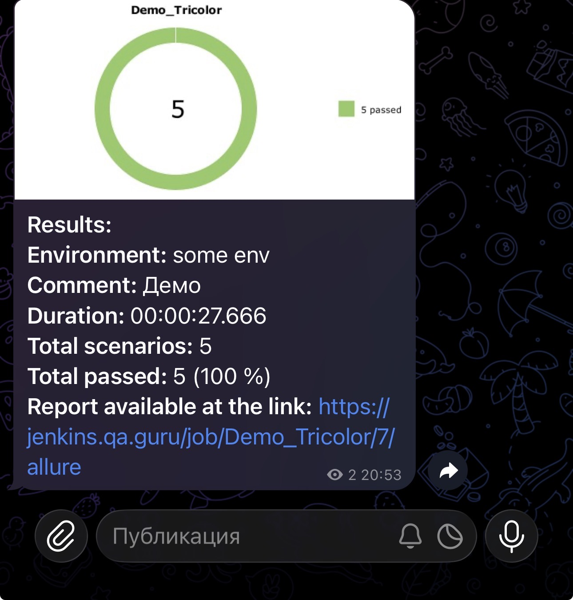

<p align="center">
  
</p>

# Tricolor UI Test Automation

Демонстрационный проект с UI-автотестами для сайта [Триколор](https://www.tricolor.ru/).

* 🔗 **Сборка проекта в Jenkins:** [Перейти в Jenkins](<https://jenkins.qa.guru/job/Demo_Tricolor/>)
* 📊 **Актуальный отчёт Allure:** [Открыть Allure Report](<https://jenkins.qa.guru/job/Demo_Tricolor/15/allure/>)

## Содержание

- [Используемый стек](#используемый-стек)
- [Что тестируется](#что-тестируется)
- [Структура проекта](#структура-проекта)
- [Локальный запуск](#локальный-запуск)
- [Запуск тестов](#запуск-тестов)
- [Формирование Allure-отчёта](#формирование-allure-отчёта)
- [Запуск в Jenkins](#запуск-в-jenkins)
- [Уведомления в Telegram](#уведомления-в-telegram)
- [Демонстрация UI-теста](#демонстрация-ui-теста)

Проект демонстрирует автоматизацию пользовательских сценариев веб-приложения: запуск тестов, формирование Allure-отчётов
и выполнение браузерных тестов в удалённой среде Selenoid.

## Используемый стек

<p align="center">
  
  &nbsp;&nbsp;
  
  &nbsp;&nbsp;
  
  &nbsp;&nbsp;
  
  &nbsp;&nbsp;
  
  &nbsp;&nbsp;
  
</p>

- **Python** — язык программирования, на котором написаны автотесты.
- **Selenium WebDriver** — библиотека для управления браузером и взаимодействия с элементами веб-страницы.
- **Pytest** — фреймворк для организации, запуска и параметризации тестов.
- **Allure Report** — инструмент для формирования интерактивных отчётов о результатах тестирования.
- **Jenkins** — сервер непрерывной интеграции для автоматического запуска тестов и публикации результатов.
- **Selenoid** — сервис для запуска удалённых браузерных сессий в Docker-контейнерах.

## Что тестируется

Автоматизированы пользовательские сценарии:

- **Геолокация:** отклонение автоматически определенного ГЕО; выбор и смена ГЕО вручную.
- **Чат поддержки:** отправка валидных сообщений, сохранение черновика текста, сворачивание виджета и скрытие иконки чата, негативные сценарии.
- **Поиск:** поиск из хэдэра по валидным запросам, обработка ошибок валидации.
- **Навигация:** переход в онлайн-кинотеатр с откртиыем в новой вкладке.
- **Проверка подписок:** валидация формы проверки подписок.

<details>
<summary><b>📁 Структура проекта</b></summary>

## Структура проекта

```text
TricolorPA/
├── core/                       
│   └── browser.py/             # Обертка над WebDriver (ожидания, клики, скролл)
│
├── media/
│   └── gif/                    # Гифки демонстрации прогона тестов
│   └── icons/                  # Иконки технологий для README
│   └── images/                 # Скриншоты отчетов, сборок, уведомлений
│
├── pages/
│   ├── components/             # Переиспользуемые UI-компоненты
│   │   ├── chat_widget.py      # Виджет чата поддержки
│   │   ├── geo_window.py       # Поп-ап и модальноре окно выбора ГЕО
│   │   ├── header.py           # Шапка (хэдэр)
│   │   └── search_in_header.py # Выпадающая строка поиска в хэдэре
│   ├── base_page.py            # Базовый класс страниц
│   ├── main_page.py            # Главная страница сайта
│   └── search_page.py          # Страница результатов поиска
│
├── tests/                      # Автотесты
│   └── test_demo.py            # Тесты для страниц демонстрации
│
├── utils/                      # Вспомогательные утилиты и хелперы
│   └── attach.py               # Модуль для добавления вложений
│ 
├── .env                        # Переменное окружение
├── conftest.py                 # Фикстуры Pytest и настройка браузера с подключением к Selenoid
├── pytest.ini                  # Конфигурация Pytest
├── requirements.txt            # Зависимости проекта
└── README.md                   # Документация проекта
```
</details>
<details>
<summary><b>📁 Установка и настройка окружения</b></summary>

## Локальный запуск

1. Клонируйте репозиторий:

```bash
git clone https://github.com/corvuscorvx/TricolorPA.git
```

2. Создайте виртуальное окружение `.venv`:

```bash
python -m venv .venv
.venv\Scripts\Activate
```
3. Установите зависимости:

```bash
pip install -r requirements.txt
```

4. Создайте файл `.env` в корне проекта и укажите параметры подключения:

```
BASE_URL=https://www.tricolor.ru/
SELENOID_URL=<адрес_вашего_selenoid>
SELENOID_LOGIN=<логин>
SELENOID_PASSWORD=<пароль>
```
</details>
<details>
<summary><b>📁 Запуск тестов</b></summary>

## Запуск тестов

Перед запуском убедитесь, что виртуальное окружение `.venv` активировано и вы находитесь в корневой папке проекта.

### Запуск всех UI-тестов:

```bash
pytest -v tests/test_demo.py
```

- `pytest` — запускает тестовый фреймворк Pytest.
- `-v` (`verbose`) — выводит название и статус каждого теста.
- `tests/test_demo.py` — путь к файлу с UI-автотестами.

### Запуск одного теста:

Чтобы запустить конкретный тест из файла, укажите его имя через `::`:

```bash
pytest -v tests/test_demo.py::<имя_теста>
```

### Запуск с увеличенной детализацией:

```bash
pytest -vv tests/test_demo.py
```

Ключ `-vv` увеличивает подробность вывода Pytest по сравнению с `-v`, показывая полный diff значений в проверках `assert` при падении теста.

</details>
<details>
<summary><b>📁 Allure</b></summary>

## Формирование Allure-отчёта

Настройки формирования результатов Allure определены в файле `pytest.ini`:

```ini
[pytest]
addopts = --clean-alluredir --alluredir=allure-results
```

После завершения тестового прогона результаты сохраняются в папку `allure-results`. Для генерации и открытия интерактивного HTML-отчёта выполните:

```bash
allure serve allure-results
```

### Отчет Allure

> Для работы команды `allure serve` на компьютере должны быть установлены Java и Allure Report Engine.

</details>




<details>
<summary><b>📁 Jenkins</b></summary>

## Запуск в Jenkins

Проект интегрирован с Jenkins для автоматического запуска UI-тестов.

Во время сборки Jenkins получает код из репозитория, устанавливает зависимости, запускает Pytest и формирует результаты
для Allure Report. Браузерные сессии создаются в удалённой среде Selenoid.

> Jenkins и Selenoid развёрнуты в личной тестовой инфраструктуре. Параметры подключения к Selenoid и конфиденциальные
> данные хранятся в переменных окружения и не публикуются в репозитории.

### Сборка в Jenkins

</details>



<details>
<summary><b>📁 Telegram</b></summary>

## Уведомления в Telegram

После завершения Jenkins-сборки Telegram-бот отправляет уведомление с результатом выполнения UI-тестов.

Уведомление содержит статус сборки, краткую информацию о тестовом прогоне и ссылку на Allure-отчёт.

> Токен Telegram-бота, идентификатор чата и другие конфиденциальные параметры хранятся в переменных окружения и не
> публикуются в репозитории.

### Уведомление от бота

</details>



### Демонстрация UI-теста

